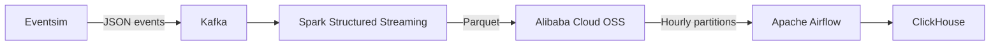

# Real-Time Music Data Pipeline

A real-time data engineering project for ingesting simulated music-streaming events, processing them with Spark Structured Streaming, storing Parquet data in Alibaba Cloud OSS, and loading hourly partitions into ClickHouse with Apache Airflow.

> **Project status:** This is a learning project. The repository contains the Kafka, Spark, Airflow, and ClickHouse code/configuration, but does not currently include Eventsim launch assets or a pinned Spark installation. End-to-end behavior depends on the user's external OSS account and runtime setup. See [Limitations](#limitations) before running it.

## Project objective

The pipeline simulates activity in a music application, including listening, authentication, and page-view events. Kafka buffers the event streams; Spark parses JSON messages and writes time-partitioned Parquet files to OSS; Airflow schedules hourly loads into ClickHouse for SQL analysis.

The simulated user population is a generator setting, not a benchmark of concurrent real users or production throughput.
##  BI visual of final result

(https://liqi246.github.io/real-time-music-data-pipeline/report.html)


## Architecture



## Technology stack

| Area | Technology | Role |
|---|---|---|
| Event generation | Eventsim | Produces synthetic music-app events |
| Message broker | Apache Kafka, ZooKeeper | Buffers events for streaming consumers |
| Stream processing | Apache Spark Structured Streaming | Parses JSON, derives time fields, and writes Parquet |
| Object storage | Alibaba Cloud OSS | Stores processed event data and Spark checkpoints |
| Workflow orchestration | Apache Airflow | Schedules hourly OSS-to-ClickHouse loads |
| Analytics database | ClickHouse | Stores queryable event tables |
| Local services | Docker Compose | Runs Kafka, ClickHouse, and Airflow services |

## Data flow

1. Eventsim generates `listen_events`, `auth_events`, and `page_view_events`.
2. Kafka receives the JSON records in matching topics.
3. Each Spark job reads one topic, applies the schema in `spark_streaming/schema.py`, converts event timestamps, and writes Parquet to OSS.
4. Airflow runs the event-specific DAGs and calls the shared loader in `airflow/dags/hourly_loader.py`.
5. The loader reads Parquet objects for the target hour and inserts rows into the corresponding ClickHouse table.

## Repository structure

```text
.
├── airflow/
│   ├── dags/                   # Hourly DAGs and shared OSS-to-ClickHouse loader
│   ├── Dockerfile
│   └── docker-compose.yaml
├── clickhouse/
│   ├── sql/init_table.sql     # Event table definitions
│   └── docker-compose.yaml
├── kafka/docker-compose.yml   # Kafka, ZooKeeper, Schema Registry, Control Center
├── spark_streaming/
│   ├── process_*_events.py    # One Structured Streaming job per event topic
│   ├── schema.py
│   └── streaming_functions.py
├── .env.example
└── README.md
```

## Prerequisites

- Ubuntu or another Linux environment for the documented host-based Spark setup.
- Docker Engine and the Docker Compose plugin.
- Java and Apache Spark installed on the host for the Spark scripts.
- Spark Kafka and Hadoop OSS connectors compatible with the installed Spark/Hadoop versions.
- An Alibaba Cloud account, an OSS bucket, and credentials with the required bucket access.
- An Eventsim producer configured to publish to the Kafka topics in this project.

The repository currently does not pin the host Spark distribution or connector versions. Connector versions must match the local Spark and Hadoop installation; see [Limitations](#limitations).

## Configuration

From the repository root, create a local environment file:

```bash
cp .env.example .env
```

Edit `.env` and replace every placeholder. The file contains:

| Variable | Used by | Description |
|---|---|---|
| `AIRFLOW_SECRET_KEY` | Airflow | Secret key shared by Airflow services |
| `AIRFLOW_ADMIN_USERNAME` | Airflow | Initial web UI account name |
| `AIRFLOW_ADMIN_PASSWORD` | Airflow | Initial web UI password; choose a strong value |
| `AIRFLOW_ADMIN_EMAIL` | Airflow | Initial administrator email |
| `OSS_ACCESS_KEY_ID` / `OSS_ACCESS_KEY_SECRET` | Spark and Airflow | OSS credentials; do not commit or share them |
| `OSS_ENDPOINT` | Spark and Airflow | OSS endpoint for the bucket's region |
| `OSS_BUCKET` | Spark and Airflow | Bucket used for Parquet files and checkpoints |
| `CLICKHOUSE_HOST` / `CLICKHOUSE_PORT` | Airflow | ClickHouse host and HTTP port reachable from Airflow |
| `CLICKHOUSE_USER` / `CLICKHOUSE_PASSWORD` | ClickHouse and Airflow | ClickHouse login credentials |
| `KAFKA_HOST` / `KAFKA_PORT` | Host Spark jobs | Kafka address reachable from the machine running Spark |

Keep `.env` private. Do not paste credentials into issues, screenshots, logs, or commits. The checked-in `.env.example` is a template, not a working credential file.

## Deployment

Run commands from the repository root unless noted otherwise. Compose files are separate, so each command explicitly selects its file.

### 1. Start Kafka

```bash
docker compose -f kafka/docker-compose.yml up -d
docker compose -f kafka/docker-compose.yml ps
```

The broker exposes `localhost:9092` to host applications. Containers on the Kafka Compose network use `broker:29092`. Confirm the three topics exist before starting Spark.

### 2. Start ClickHouse

```bash
docker compose --env-file .env -f clickhouse/docker-compose.yaml up -d
```

The initialization script creates the `streamify` database and event tables when ClickHouse initializes a fresh data volume. Existing volumes are preserved; the initialization script is not automatically reapplied to an already initialized volume.

### 3. Start Airflow

```bash
docker compose --env-file .env -f airflow/docker-compose.yaml up --build -d
docker compose --env-file .env -f airflow/docker-compose.yaml ps
```

Open `http://localhost:8080` and sign in with the administrator credentials from `.env`. Airflow task execution additionally requires valid OSS and ClickHouse settings.

### 4. Start Eventsim

Run an Eventsim producer configured to publish `listen_events`, `auth_events`, and `page_view_events` to the Kafka broker. The Eventsim image build/run configuration is not currently included in this repository; a producer setup must be supplied separately.

### 5. Start Spark streaming jobs

Export the OSS variables from `.env` in the shell where Spark runs and set the host-reachable Kafka address:

```bash
export KAFKA_HOST=localhost
export KAFKA_PORT=9092
export OSS_ENDPOINT=https://oss-cn-hangzhou.aliyuncs.com
export OSS_BUCKET=your_bucket_name
export OSS_ACCESS_KEY_ID=your_access_key_id
export OSS_ACCESS_KEY_SECRET=your_access_key_secret
```

Start each job in its own terminal after configuring compatible Kafka and OSS connectors. Example:

```bash
spark-submit spark_streaming/process_listen_events.py
```

Repeat with `process_auth_events.py` and `process_page_view_events.py`. Spark jobs are long-running; leave their terminals open while streaming.

### 6. Run and inspect hourly loads

The DAGs are scheduled hourly and target a completed hour. In Airflow, inspect the DAG run and task state/logs. A trigger being accepted or a container being `Up` does not prove a successful load.

## Validation checklist

Verify each boundary independently:

1. Kafka topics exist and have event offsets/messages.
2. Spark jobs start without connector errors and remain active.
3. Parquet objects appear under the expected event prefix in OSS.
4. The Airflow task for a completed hour succeeds.
5. ClickHouse contains rows for that event and hour; compare timestamp ranges and counts with the Parquet input.

Example ClickHouse check:

```sql
SELECT year, month, day, hour, count()
FROM streamify.listen_events
GROUP BY year, month, day, hour
ORDER BY year DESC, month DESC, day DESC, hour DESC;
```

Repeat for `auth_events` and `page_view_events`.

## Limitations and next steps

- Eventsim build and launch assets are not included, so the producer cannot yet be reproduced from this repository alone.
- Spark and connector versions are not pinned; add a documented, tested runtime combination or package Spark in a container.
- Spark writes partitions by `month/day/hour` without `year`, while the Airflow loader filters rows by year. Add `year` to the storage partition scheme and update the loader together.
- The README records an observed eight-hour discrepancy between partition paths and event timestamps. Align Spark and Airflow time zones and validate around hour/day/year boundaries before relying on hourly results.
- The loader deletes an existing hour before inserting staged files. A failure during insertion may leave a partial hour; use a safer staging/swap strategy before treating the loader as production-safe.
- Add automated data-quality checks for row counts, nulls, duplicate handling, and time-partition consistency.

## Acknowledgements

This project was inspired by [ankurchavda/streamify](https://github.com/ankurchavda/streamify), which demonstrates a related music-event streaming architecture using Kafka, Spark, Airflow, and Google Cloud services. This repository adapts the learning project to Alibaba Cloud OSS and ClickHouse.

